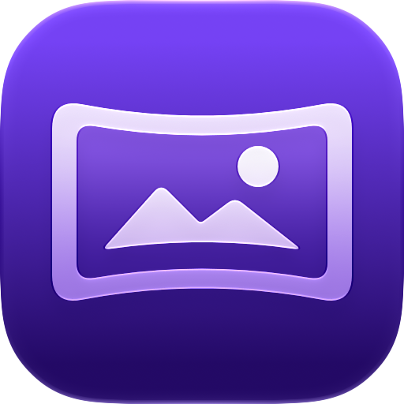

# HDRI kit

**Stitch a pile of photos into a 360° HDRI — on your Mac.**

[**Download the latest DMG**](https://github.com/x-m4v/HDRI-kit/releases/download/v0.6.0-beta/HDRI.kit.dmg) · [Русская версия](README.ru.md)

## New in 0.6.0 beta

Stitching is faster and uses less memory. Frames with missing focal-length metadata are aligned by image content, and Maximum mode refines matches to subpixel precision. The update also adds a live progress counter and cache controls, and reduces memory use for Radiance HDR export. [Read the full release notes](https://github.com/x-m4v/HDRI-kit/releases/tag/v0.6.0-beta).

## Beta software

HDRI kit turns overlapping photos into a 360° × 180° panorama for lighting and backgrounds in 3D. This public beta can struggle with difficult overlaps.

## Requirements

An Apple Silicon Mac running macOS 27. Recommended memory is 16 GB or more.

## Install

Open the DMG and drag HDRI kit to Applications. If macOS blocks the beta on first launch, go to System Settings → Privacy & Security and choose **Open Anyway**.

## Quick start

1. In **Create**, add at least two overlapping photos.
2. Pick **Fast** to check coverage or leave **Maximum** selected for the final stitch. Click **Stitch Panorama**.
3. Inspect the seams in the editor and export EXR, HDR or PNG.

[All features](FEATURES.md) · [User manual (HTML)](https://x-m4v.github.io/HDRI-kit/manual/HDRI-kit-EN.html)

## Support the project

HDRI kit is free to use. If you’d like to support its development, you can do so on Boosty.

## Feedback

Found a bug or have a shoot that won't stitch? [Open an issue](../../issues) and include:
- your macOS version and Mac model;
- the camera / phone and lens, and how many photos;
- the quality mode you used;
- a screenshot of the result, if it's wrong.

Please don't attach photos you wouldn't want public.

## Credits

- [OpenCV](https://opencv.org) (Apache‑2.0), [OpenColorIO](https://opencolorio.org) and the ACES configs (BSD‑3‑Clause), Khronos PBR Neutral (Apache‑2.0) — see [THIRD_PARTY_NOTICES.md](THIRD_PARTY_NOTICES.md).

## License

Free to use under the [HDRI kit License](LICENSE) — all rights reserved, source code is not published. Third-party components: see [THIRD_PARTY_NOTICES.md](THIRD_PARTY_NOTICES.md).

From Russia with love ♥
