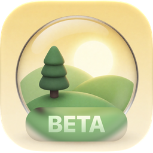

<div align="center">



# HDRI kit

**Stitch a pile of photos into a 360° HDRI — on your Mac.**

[](#requirements)
[](#requirements)
[](#beta-software)
[](LICENSE)

[**Download the latest DMG**](../../releases/latest) · [Русская версия](README.ru.md)

</div>

---

## Beta software

**HDRI kit is in public beta.** It works, I use it, but it is young: expect rough edges, the occasional failed stitch, and features that are still on the roadmap. It will keep **improving and updating** as I use it and as people send feedback. If something goes wrong, please [open an issue](../../issues) — beta feedback is the most useful thing you can give this project.

---

## What is it?

HDRI kit turns an ordinary set of photos — shot with a phone, an ultra‑wide lens, a mirrorless camera, handheld or on a tripod — into a full **360° × 180° equirectangular panorama** you can use as an HDRI for lighting and backgrounds in Blender, Houdini, Unreal, Unity, Nuke, Maya and anything else that eats `.exr` or `.hdr`.

You drop in the photos, pick a speed, press **Stitch Panorama**. That's it. No control points, no project files to babysit.

It is built natively for the Mac: SwiftUI with Liquid Glass, Metal for rendering, OpenCV for registration.

## Requirements

- **macOS 27** on an **Apple Silicon** Mac.
- 16 GB of RAM or more is comfortable; the app keeps its frames within about a quarter of your Mac's memory.

## Install

1. Download **`HDRI kit.dmg`** from the [latest release](../../releases/latest).
2. Open it and drag **HDRI kit** to **Applications**.
3. **First launch:** the beta is not yet notarized by Apple (that needs a paid developer account), so macOS will refuse to open it the first time. This is expected. To allow it:
   - Try to open the app once, then close the warning.
   - Open **System Settings → Privacy & Security**, scroll down and click **Open Anyway** next to *“HDRI kit” was blocked*.
   - Confirm with your password. You only have to do this once.

   Prefer the Terminal? This does the same thing:
   ```sh
   xattr -dr com.apple.quarantine "/Applications/HDRI kit.app"
   ```

## Quick start

1. Open **Create**, click **+** (or drag your photos in).
2. Choose **Fast / Balanced / Maximum**.
3. Press **Stitch Panorama**.
4. Check the result in the flat or sphere view; fix or hide frames if needed.
5. Press **Export…**, choose format, size and colour space.

**Shooting tips.** Overlap neighbouring frames by roughly a third. Shoot the whole sphere including sky and floor. Rotate around the camera rather than walking around it — the closer objects are, the more parallax shows up as ghosting. A tripod isn't required, but it helps. For HDR, bracket however you like; the app will sort it out. **Shoot RAW (ProRAW) for HDRI:** iPhone HEIC is tone‑mapped differently in every frame.

## Support the project

HDRI kit is free and will stay free. If it saves you time, you can support development on Boosty — it goes straight into new features and, eventually, a notarized build and the Mac App Store.

[**Support on Boosty →**](https://boosty.to/m4v/donate)

## Features

**Stitching that tolerates real‑world shooting**
- Any order, any camera, any mix of lenses. Fisheye is recognised from the lens name.
- A cascade that spends effort only where it's needed: a quick pass at ~1 MP, then a higher‑resolution pass only for the frames that didn't attach, then the phone's gravity and compass sensors as a last resort.
- Sensors are used as hints, not trusted blindly. Gravity (reliable) and compass heading (often not — on handheld iPhone shoots it can be off by up to 180°) are handled separately: neighbours are searched by height above the horizon, and a match that contradicts the compass is accepted when two neighbours agree on the same place. The horizon is levelled by gravity.
- The focal length from EXIF is refined as part of the solve and used for every frame, because ultra‑wide cameras are often a few percent off — a common cause of panoramas that don't close.
- Deterministic: the same photos always give the same panorama.

**Real HDR, not tone‑mapped fakes**
- Exposure brackets can be shot *however you like*: handheld, shuffled, with no fixed pattern. Frames of the same position are grouped into stacks automatically (by capture time, image content and sensors).
- Linear half‑float pipeline. RAW files are decoded linearly; HEIC with a gain map is expanded to HDR. Per‑frame exposure comes from EXIF and is refined from overlaps.
- Three‑band blending: sky tone and lens flare blend smoothly, detail stays sharp.
- **Ghost removal:** where frames disagree (people and cars that moved, a hand‑held bracket shifted by a few pixels) each point comes from the frames that agree — only real pixels, no blending into semi‑transparent ghosts.
- **Honest data:** every pixel knows whether it was clipped in every exposure; the **HDR quality report** gives a verdict and a recipe ("the sun is clipped — shoot it again with a 12–16‑stop ND"), with a source badge (RAW / HEIC gain map / sRGB). Uncaptured areas are filled smoothly and marked as synthetic.
- **ND filters and sun brackets:** tell the app which frames were shot through an ND (stops, ND1000, d3.0); a dark sun bracket is used only where everything else is clipped.

**A quality switch**
- **Fast** — quick sanity check of a shoot.
- **Balanced** — the sensible default.
- **Maximum** — more points, all pairs, higher resolution. Slower, catches almost everything.

**Look, check, fix**
- Flat and sphere preview with zoom and pan. Double‑click anywhere to select the frame that covers that spot.
- Frame list grouped by *All / Positions / Exposures*, with EV badges and photo metadata.
- Fix any frame by hand: full yaw / pitch / roll (±180°), quick 90° / 180° turns, scale, or simply **drag it on the panorama**. Hide it, or delete it and restitch.
- Exposure stacks are linked with a lock (they select and move together) — unlock to move one exposure on its own. If the stitch split one position in two, **drag a frame onto the other position** to merge them.
- **Undo / Redo** (⌘Z / ⇧⌘Z) for deletes, moves and every manual fix.
- **Reference‑accurate preview transforms:** Standard (sRGB), **ACES 2.0** SDR and **HDR (EDR)**, ACES 1.3, Khronos PBR Neutral, Raw. The ACES shaders are generated by OpenColorIO from the official ACES configs; *Help → Check Preview Accuracy* compares the GPU output with OpenColorIO.
- **Proxy** switch for smooth dragging; 8K preview at rest.
- View‑only grading for inspection: exposure, contrast, highlights, shadows, gamma, temperature, tint, saturation, histogram, clipped‑pixel overlay and false colour (stops). It never affects the export. Load your own **.cube LUT** for the view.
- **Render mode:** a path‑traced 18% gray ball, a chrome ball and a floor lit only by your panorama — check the light and the sun shadows before you leave the app.
- **Scene:** one white balance with an eyedropper, north to the center from the iPhone compass, horizon by two points.
- **Retouch:** Exclude / Force masks per position, nadir fill that rebuilds the tripod circle from patches of the real ground around it (marked as synthetic), optional graph‑cut seams, and a stitch check that measures each frame's seam error in pixels of an 8K panorama.

**Export**
- Formats: **OpenEXR** (half or 32‑bit float, ZIP / PIZ / ZIPS, `envmap = latlong`, chromaticities, capture metadata, optional `mask.saturated` / `mask.synthetic` channels), **Radiance HDR**, **16‑bit PNG**.
- Sizes from 2K to 16K (always 2:1).
- Colour spaces: Linear Rec.709, ACEScg, Linear Display P3, sRGB, Display P3.

**Projects**
- Every stitch is saved automatically with its frames and your manual adjustments.
- Projects reopen in about a second: decoded frames are cached inside the project.
- Choose whether a project keeps *copies* of the photos (always reopens) or just *links* to the originals (uses almost no disk space).

**And**
- English and Russian interface (Settings → Language), accent colour (Settings → Appearance).
- Runs fully offline. No accounts, no analytics, no network code.

## Feedback

Found a bug or have a shoot that won't stitch? [Open an issue](../../issues) and include:
- your macOS version and Mac model;
- the camera / phone and lens, and how many photos;
- the quality mode you used;
- a screenshot of the result, if it's wrong.

Please don't attach photos you wouldn't want public.

## Credits

- [OpenCV](https://opencv.org) (Apache‑2.0), [OpenColorIO](https://opencolorio.org) and the ACES configs (BSD‑3‑Clause), Khronos PBR Neutral (Apache‑2.0) — see [THIRD_PARTY_NOTICES.md](THIRD_PARTY_NOTICES.md).

## License

Free to use under the [HDRI kit License](LICENSE) — all rights reserved, source code is not published. Third-party components: see [THIRD_PARTY_NOTICES.md](THIRD_PARTY_NOTICES.md).

<sub>From Russia with love ♥</sub>
