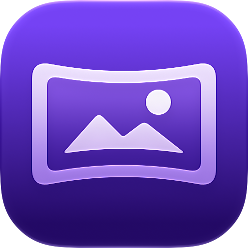

# HDRI kit

**Сшивает 360° HDRI из серии фотографий — прямо на вашем Mac.**

[**Скачать последний DMG →**](https://github.com/x-m4v/HDRI-kit/releases/download/v0.6.0-beta/HDRI.kit.dmg) · [English](README.md)

## Что нового в 0.6.0 beta

Сшивка быстрее и требует меньше памяти. Кадры без фокусного расстояния в EXIF привязываются по изображению, а в режиме «Максимум» совпадения уточняются до долей пикселя. Добавлены счётчик прогресса и очистка кэша, а экспорт Radiance HDR требует меньше памяти. [Полное описание релиза](https://github.com/x-m4v/HDRI-kit/releases/tag/v0.6.0-beta).

## Бета-версия

HDRI kit собирает перекрывающиеся фотографии в панораму 360° × 180° для освещения и фона в 3D. Публичная бета может ошибаться на сложных стыках.

## Требования

Mac на Apple Silicon с macOS 27. Рекомендуется от 16 ГБ памяти.

## Установка

Откройте скачанный DMG и перетащите HDRI kit в «Программы». Если macOS заблокирует первый запуск беты, откройте «Системные настройки → Конфиденциальность и безопасность» и нажмите «Всё равно открыть».

## Быстрый старт

1. На вкладке «Создать» добавьте минимум два перекрывающихся снимка.
2. Выберите «Быстро» для проверки покрытия или оставьте «Максимум» для итоговой сшивки. Нажмите «Сшить панораму».
3. Проверьте стыки в редакторе и экспортируйте EXR, HDR или PNG.

[Все возможности](FEATURES.ru.md) · [Руководство пользователя (HTML)](https://x-m4v.github.io/HDRI-kit/manual/HDRI-kit-RU.html)

## Поддержать проект

HDRI kit бесплатен. Если вам хочется поддержать его разработку, это можно сделать на Boosty.

## Обратная связь

Нашли баг или есть съёмка, которая не сшивается? [Создайте issue](../../issues) и укажите:
- версию macOS и модель Mac;
- камеру или телефон, объектив и количество фото;
- режим качества;
- скриншот результата, если он неверный.

Пожалуйста, не прикладывайте фото, которые не хотели бы выкладывать публично.

## Благодарности

- [OpenCV](https://opencv.org) (Apache‑2.0), [OpenColorIO](https://opencolorio.org) и конфиги ACES (BSD‑3‑Clause), Khronos PBR Neutral (Apache‑2.0) — см. [THIRD_PARTY_NOTICES.md](THIRD_PARTY_NOTICES.md).

## Лицензия

Бесплатно по [лицензии HDRI kit](LICENSE) — все права защищены, исходный код не публикуется. Сторонние компоненты: [THIRD_PARTY_NOTICES.md](THIRD_PARTY_NOTICES.md).

From Russia with love ♥
