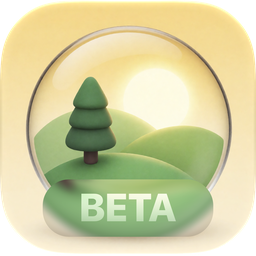

<div align="center">



# HDRI kit

**Сшивает 360° HDRI из кучи фотографий — прямо на вашем Mac.**

[](#требования)
[](#требования)
[](#бета-версия)
[](LICENSE)

[**Скачать последний DMG →**](../../releases/latest) · [English](README.md)

</div>

---

## Бета-версия

**HDRI kit сейчас в публичной бете.** Приложение работает, я им пользуюсь, но оно молодое: возможны шероховатости, иногда сшивка не получается, а часть возможностей ещё в планах. Оно будет **обновляться и улучшаться** по мере того, как я им пользуюсь и получаю отзывы. Если что-то пошло не так — [создайте issue](../../issues): отзывы с беты — самое полезное, что можно дать проекту.

---

## Что это

HDRI kit превращает обычный набор фотографий — снятых на телефон, сверхширокоугольный объектив, беззеркалку, с рук или со штатива — в полную **эквиректангулярную панораму 360° × 180°**. Её можно использовать как HDRI для освещения и фона в Blender, Houdini, Unreal, Unity, Nuke, Maya и везде, где понимают `.exr` и `.hdr`.

Вы бросаете фото, выбираете скорость и нажимаете **«Сшить панораму»**. Без контрольных точек и ручной возни с проектами.

Приложение написано под Mac: SwiftUI с Liquid Glass, Metal для рендера, OpenCV для совмещения кадров.

## Возможности

**Сшивка, которая прощает реальную съёмку**
- Любой порядок кадров, любая камера, любая смесь объективов. Фишай распознаётся по названию объектива.
- Каскад, который тратит усилия только там, где нужно: быстрый проход на ~1 Мп, затем повышенное разрешение только для кадров, что не села, и, наконец, датчики гравитации и компаса.
- Датчики — подсказка, а не истина. Гравитация (надёжна) и азимут компаса (часто врёт — при съёмке iPhone с рук вплоть до 180°) учитываются раздельно: соседи ищутся по высоте над горизонтом, а связь против компаса принимается, если две опоры указывают одно и то же место. Горизонт выравнивается по гравитации.
- Фокусное расстояние из EXIF уточняется прямо в расчёте и используется для всех кадров: у сверхширика оно нередко «гуляет» на несколько процентов — частая причина панорам, которые не замыкаются.
- Повторяемость: одни и те же фото всегда дают одну и ту же панораму.

**Настоящий HDR, а не тонмаппинг**
- Брекеты можно снимать *как угодно*: с рук, вперемешку, без заданной схемы. Кадры одной позиции автоматически собираются в стопки (по времени съёмки, по изображению и по датчикам).
- Линейный конвейер в half float. RAW читается линейно; HEIC с gain map разворачивается в HDR. Экспозиция каждого кадра берётся из EXIF и уточняется по перекрытиям.
- Смешивание в три полосы: тон неба и засветка объектива переходят плавно, детали остаются резкими.
- **Удаление призраков:** там, где кадры не согласны (сдвинувшиеся люди и машины, брекет с рук, сдвинутый на пару пикселей), точка берётся из согласных кадров — только реальные пиксели, без полупрозрачных «призраков».
- **Честные данные:** каждый пиксель знает, пересвечен ли он во всех экспозициях; **отчёт о качестве HDR** даёт вывод и рецепт («солнце пересвечено — доснимите с ND на 12–16 стопов») и бейдж источника (RAW / HEIC gain map / sRGB). Неснятые места заливаются плавно и помечаются как синтетика.
- **ND-фильтры и солнечный брекет:** укажите, какие кадры сняты через ND (стопы, ND1000, d3.0); тёмный кадр солнца используется только там, где всё остальное пересвечено.

**Переключатель качества**
- **Быстро** — проверить, как сложилась съёмка.
- **Баланс** — разумный вариант по умолчанию.
- **Максимум** — больше точек, все пары, выше разрешение. Дольше, но цепляет почти всё.

**Посмотреть, проверить, поправить**
- Плоский и сферический просмотр с зумом и сдвигом. Двойной клик в любом месте выбирает кадр, который закрывает эту точку.
- Список кадров с группировкой «Все / Позиции / Экспозиции», значками EV и метаданными.
- Любой кадр можно поправить вручную: полный поворот / наклон / крен (±180°), быстрые повороты на 90° и 180°, масштаб — или просто **перетащить его прямо на панораме**. Кадр можно убрать из панорамы или удалить и пересшить.
- Экспозиции одной позиции связаны замочком (выделяются и двигаются вместе) — откройте замок, чтобы подвинуть одну. Если сшивка разделила одну позицию на две, **перетащите кадр на другую позицию** — они объединятся.
- **Отмена и повтор** (⌘Z / ⇧⌘Z) для удаления, перемещения и любых ручных правок.
- **Эталонные преобразования просмотра:** Standard (sRGB), **ACES 2.0** SDR и **HDR (EDR)**, ACES 1.3, Khronos PBR Neutral, Raw. Шейдеры ACES генерирует OpenColorIO из официальных конфигов ACES; «Справка → Проверить точность просмотра» сравнивает результат GPU с OpenColorIO.
- Переключатель **«Прокси»** для плавного перетаскивания; превью 8K в покое.
- Коррекция только для просмотра: экспозиция, контраст, светлые, тени, гамма, температура, оттенок, насыщенность, гистограмма, пересветы/провалы и ложные цвета (стопы). На экспорт она не влияет. Можно загрузить свой **LUT .cube** для просмотра.
- **Режим «Рендер»:** серый шар 18%, хромированный шар и пол, освещённые только вашей панорамой (трассировка путей), — проверьте свет и тени от солнца, не выходя из приложения.
- **Сцена:** единый баланс белого с пипеткой, север в центр по компасу iPhone, горизонт по двум точкам.
- **Ретушь:** маски «Исключить / Принудительно» по позициям, заполнение надира, которое собирает круг штатива из кусочков настоящей земли вокруг (помечается как синтетика), швы graph-cut по желанию и проверка сшивки — ошибка шва каждого кадра в пикселях 8K-панорамы.

**Экспорт**
- Форматы: **OpenEXR** (half или 32-битный float, ZIP / PIZ / ZIPS, `envmap = latlong`, chromaticities, метаданные съёмки, по желанию каналы `mask.saturated` / `mask.synthetic`), **Radiance HDR**, **PNG 16 бит**.
- Размеры от 2K до 16K (всегда 2:1).
- Цветовые пространства: Linear Rec.709, ACEScg, Linear Display P3, sRGB, Display P3.

**Проекты**
- Каждая сшивка сохраняется автоматически вместе с кадрами и ручными правками.
- Проекты открываются примерно за секунду: проявленные кадры кэшируются внутри проекта.
- Можно хранить в проекте *копии* фото (откроется всегда) или только *ссылки* на оригиналы (почти не занимает места).

**Ещё**
- Интерфейс на английском и русском (Настройки → Язык), акцентный цвет (Настройки → Оформление).
- Работает полностью офлайн: ни аккаунтов, ни аналитики, ни сетевого кода.

## Требования

- **macOS 27** и Mac на **Apple Silicon**.
- Комфортно от 16 ГБ памяти; приложение держит кадры примерно в четверти оперативной памяти Mac.

## Установка

1. Скачайте **`HDRI kit.dmg`** из [последнего релиза](../../releases/latest).
2. Откройте его и перетащите **HDRI kit** в **Программы**.
3. **Первый запуск:** бета ещё не нотаризована Apple (для этого нужен платный аккаунт разработчика), поэтому macOS в первый раз откажется её открывать. Это ожидаемо. Чтобы разрешить:
   - Попробуйте открыть приложение один раз и закройте предупреждение.
   - Откройте **Системные настройки → Конфиденциальность и безопасность**, прокрутите вниз и нажмите **«Всё равно открыть»** рядом с сообщением о блокировке «HDRI kit».
   - Подтвердите паролем. Делать это нужно один раз.

   Если удобнее Терминал, то же самое делает команда:
   ```sh
   xattr -dr com.apple.quarantine "/Applications/HDRI kit.app"
   ```

## Быстрый старт

1. На вкладке **«Создать»** нажмите **+** (или перетащите фото).
2. Выберите **Быстро / Баланс / Максимум**.
3. Нажмите **«Сшить панораму»**.
4. Проверьте результат в плоском или сферическом виде; при необходимости поправьте или уберите кадры.
5. Нажмите **«Экспорт…»**, выберите формат, размер и цветовое пространство.

**Советы по съёмке.** Перекрывайте соседние кадры примерно на треть. Снимайте всю сферу, включая небо и пол. Вращайте камеру вокруг себя, а не ходите вокруг: чем ближе предметы, тем сильнее параллакс даёт двоение. Штатив не обязателен, но помогает. Для HDR делайте брекеты как удобно — приложение разберётся. **Для HDRI снимайте RAW (ProRAW):** HEIC с iPhone тонируется по-разному в каждом кадре.

## Поддержать проект

HDRI kit бесплатный и останется бесплатным. Если он экономит вам время, можно поддержать разработку на Boosty — это напрямую идёт в новые функции, а со временем — в нотаризованную сборку и Mac App Store.

[**Поддержать на Boosty →**](https://boosty.to/m4v/donate)

## Известные ограничения (бета)

- **Параллакс.** Предметы совсем рядом с камерой при съёмке с рук (столб в паре метров, люстра) могут давать небольшую «ступеньку» на стыке кадров. Повороты кадров параллакс не устраняют; при желании его можно убрать кистью «Исключить».
- **Однородные области.** Ровное небо, белые стены и вода почти не дают алгоритму зацепок. Такие кадры могут встать только по датчикам (тогда они лишь закрывают неснятое) или не попасть в панораму.
- **HEIC с iPhone** тонируется по-разному в каждом кадре, поэтому тона могут не совпасть идеально; самый чистый HDRI даёт RAW.
- **Автоопределения штатива нет** — надир заполняется кругом заданного радиуса.
- **Объективы.** Фишай определяется только по названию объектива; ручного выбора и модели дисторсии пока нет.
- **Больше всего проверено на iPhone** (ProRAW DNG и HEIC). Другие камеры должны работать, но тестировались меньше.
- **Старые проекты**, сделанные ранними внутренними сборками, лучше пересшить.
- **Сборка без подписи** — см. установку выше.

## Планы

- Аккуратные швы вокруг близких предметов с параллаксом.
- Солнце как объект: положение, `sun.json`, вариант без солнца; абсолютная калибровка света.
- Нейросетевые точки для режима «Максимум» (Core ML).
- Ручной выбор объектива и дисторсия в расчёте.
- Подписанные и нотаризованные релизы, возможно — релиз в Mac App Store.
- Возможно, версия для iPad/iPhone (интерфейс — кроссплатформенный SwiftUI, но проверяется пока только macOS).

Идеи и приоритеты приветствуются в [Issues](../../issues).

## Обратная связь

Нашли баг или есть съёмка, которая не сшивается? [Создайте issue](../../issues) и укажите:
- версию macOS и модель Mac;
- камеру или телефон, объектив и количество фото;
- режим качества;
- скриншот результата, если он неверный.

Пожалуйста, не прикладывайте фото, которые не хотели бы выкладывать публично.

## Благодарности

- [OpenCV](https://opencv.org) (Apache‑2.0), [OpenColorIO](https://opencolorio.org) и конфиги ACES (BSD‑3‑Clause), Khronos PBR Neutral (Apache‑2.0) — см. [THIRD_PARTY_NOTICES.md](THIRD_PARTY_NOTICES.md).

## Лицензия

Бесплатно по [лицензии HDRI kit](LICENSE) — все права защищены, исходный код не публикуется. Сторонние компоненты: [THIRD_PARTY_NOTICES.md](THIRD_PARTY_NOTICES.md).

<sub>From Russia with love ♥</sub>
